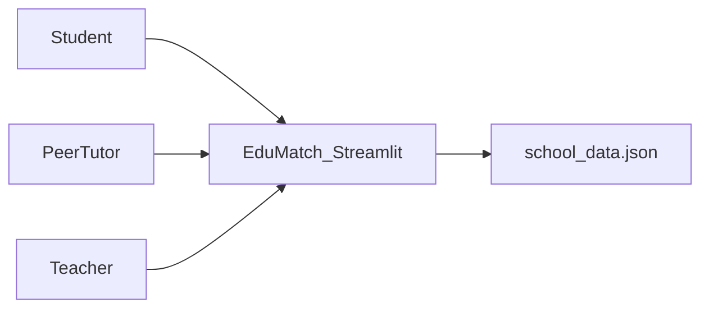

# EduMatch Project Plan

**EduMatch: Collaborative Peer and Teacher Tutoring and Gamified Doubt-Clearing Platform**

Developer: Rithvi (Class 11)

This plan turns the Peer Tutoring / Doubt-Clearing Matchmaker requirement document into a build outline for a school project report or synopsis.

## Goal

EduMatch closes the academic support gap inside a school. Students post subject-specific doubts, peer tutors write step-by-step solutions, and teachers act as master mentors who check quality.

Points and badges reward useful contributions so the platform stays active. All persistent data lives in one local JSON file. There is no SQL database.

## Stack

- **Language:** Python
- **Interface:** Streamlit, which draws the web UI from Python
- **Storage:** `school_data.json`, read and written with the built-in `json` and `os` modules
- **Data shape:** nested dictionaries and lists for users, doubts, and answers

Every action, such as posting a doubt or earning points, loads the file, updates the in-memory state, and writes the file back.

## Users

1. **Student (learner):** posts doubts, reads answers, upvotes helpful solutions, and tracks personal progress.
2. **Peer tutor (student contributor):** browses open doubts, writes step-by-step explanations, and earns points and badges.
3. **Teacher (master mentor and validator):** answers hard doubts, reviews peer submissions, awards a verified badge, and keeps answers academically sound.

A peer tutor is still a student account. The teacher role is separate and unlocks verification and higher-value scoring.

## Scoring

A simple activity score keeps the app competitive.

| Action | Points | Badge or status |
| --- | --- | --- |
| Student solves a peer doubt | +10 | Contributor |
| Teacher verifies that answer | +15 bonus | Verified Solution tag |
| Teacher solves a complex doubt directly | +25 | Master Mentor |
| Weekly top contributor | Highlight only | Subject Wizard of the Week |

The leaderboard sorts users by total points, highest first, and calls out the weekly top contributor.

## Modules

**A. Authentication and profile switching**

- Choose a profile from a pre-filled list of students and teachers.
- Detect the role immediately and change what that person can do.

**B. Doubt submission**

- Fields: student name, subject, and a detailed question.
- Subjects: Physics, Chemistry, Computer Science, Mathematics.
- New doubts start as Open.

**C. Resolution and verification**

- Show open questions grouped by subject.
- Let a solver type a step-by-step explanation.
- On submit, add the correct points and mark the doubt Resolved.
- A teacher can review a student answer and attach the Verified Solution tag, which adds the bonus points.

**D. Leaderboard and wall of fame**

- Sort users by accumulated points in descending order.
- Highlight the weekly top contributor.

## Screens

The app has three primary pages, reached from a sidebar:

1. **Leaderboard**
2. **Post a Doubt**
3. **Solve Doubts**

Students and teachers will open the app on laptops, tablets, and phones, so the layout stays responsive:

- Streamlit turns the sidebar into a slide-out menu on a narrow screen.
- `st.columns` stacks into a single column on a small viewport so the page does not scroll sideways.
- Buttons, text areas, and `st.expander` sections stay large enough to tap and read on a phone.

## Data file

`school_data.json` holds the whole school state. A practical shape:

- `users`: id, name, role (`student` or `teacher`), points, badges
- `doubts`: id, student name, subject, question, status (`Open` or `Resolved`), answers
- `answers`: author, explanation, points awarded, verified flag

`load_data()` reads the file (and creates a starter file if it is missing). `save_data()` writes the updated state after each successful action.

## Build order

1. **Setup.** Install Python and Streamlit (`pip install streamlit`).
2. **Data layer.** Write `load_data()` and `save_data()` around the `json` module so the app can read and write the local file.
3. **UI layout.** Build the sidebar and the three pages: Leaderboard, Post a Doubt, and Solve Doubts.
4. **Logic.** Connect the forms, point updates, and status changes (Open to Resolved, plus teacher verification).
5. **Testing.** Run the app in a desktop browser and a narrow mobile-width view and confirm the sidebar, columns, and controls still work.

## Done when

- A student can switch into a saved profile and post a doubt in one of the four subjects.
- A peer tutor can open that doubt, submit a step-by-step answer, and receive 10 points.
- A teacher can verify that answer (+15) or solve a complex doubt directly (+25).
- The leaderboard updates from `school_data.json` and highlights the top contributor.
- The same three pages remain usable on a narrow screen.
